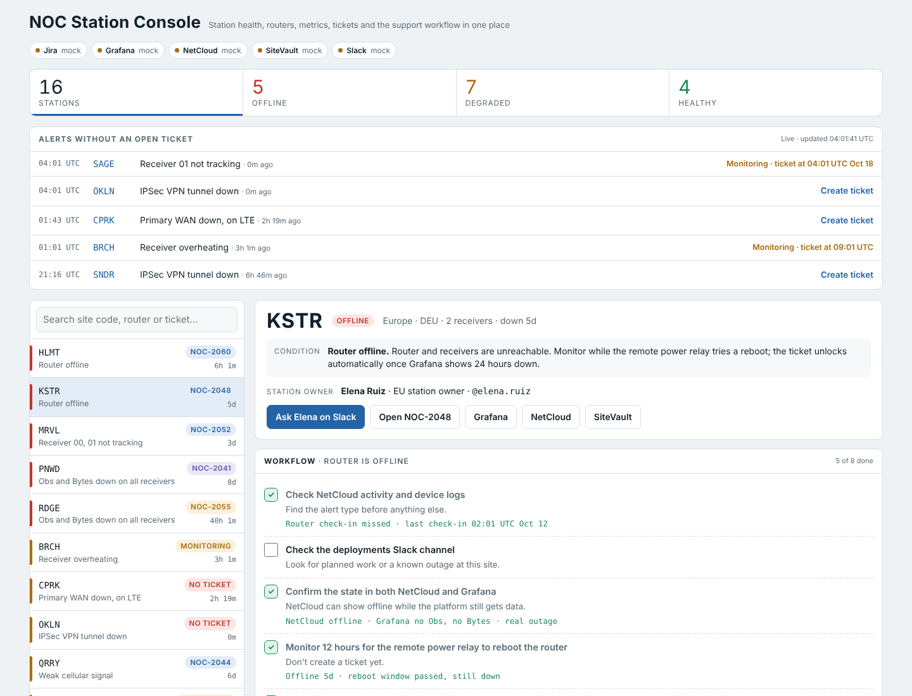
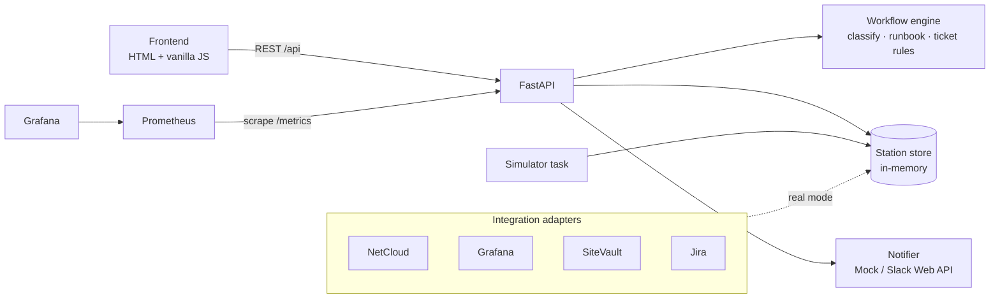

# NOC Station Console

One screen for a network operations center that monitors a fleet of GNSS reference stations. It brings together what an analyst usually checks in five separate tools (router management, metrics dashboards, site inventory, ticketing and chat), works out what is wrong with each station, and walks the analyst through the support runbook for that condition.

All data is mock. Every station, device, ticket and person. Each integration sits behind an adapter, so the mock can be swapped for the real API without touching the workflow logic.



## What it does

- **Combined station view.** Router state and cellular signal (NetCloud-style), receiver Obs/Bytes and temperature (Grafana-style), site record (SiteVault, a fictional site-inventory system), linked tickets (Jira-style), all on one page.
- **Condition detection.** Each station is classified as *router offline*, *router online but Obs down* (antenna vs. unreachable receiver vs. router-level), *DMVPN tunnel down*, *NetCloud offline but data still flowing*, *overheating*, or *network degraded*. The classification selects the matching runbook.
- **Guided runbook.** Every step the data can answer is checked automatically (logs, reachability, WAN, signal, power alerts, IP mismatch, tunnel count, temperature). The rest are checkboxes saved on the server, with ready-to-copy `ping` and `curl` commands where needed.
- **24-hour Grafana gate.** Outage tickets unlock automatically once the station has been down for 24 hours since its last observation, with a progress bar and the exact unlock time. Analysts can still override it.
- **Ticket rules, enforced by the API.** If a related ticket is still open, the API refuses a duplicate and the UI offers *Add comment* instead. If the last ticket is closed, it opens a new one. If NetCloud lost the router but data is still flowing, no ticket is needed.
- **Ask the station owner on Slack.** Stations route to an owner by region. One click sends the owner a pre-written inquiry with the station's condition, router and receiver state, and ticket.
- **Pre-filled tickets.** The ticket description includes data from all sources plus the runbook checklist with what passed and what failed.
- **Live demo simulator.** A background task breaks or recovers a station every 90 seconds, so the demo keeps changing.
- **Observable.** `/metrics` exposes Prometheus gauges (stations by status, unticketed alerts, open tickets). An optional compose profile runs Prometheus and Grafana against it.

## Architecture



| Path | What lives there |
| --- | --- |
| `backend/app/workflow.py` | Pure functions: condition detection, runbook steps, 24h gate, ticket rules. Fully unit tested. |
| `backend/app/main.py` | FastAPI routes and response views; serves the frontend. |
| `backend/app/store.py` | Mock seed data (relative to start time) and the in-memory store. |
| `backend/app/notifier.py` | `MockSlackNotifier` and a `SlackWebNotifier` that posts with `chat.postMessage`. |
| `backend/app/simulator.py` | Breaks and recovers stations for the live demo. |
| `backend/app/config.py` | Thresholds and the region → owner routing table, overridable with env vars. |
| `frontend/` | Static UI that only renders and posts actions; all logic is server-side. |

## Run it

```bash
# Docker
docker compose up --build                 # http://localhost:8000
docker compose --profile monitoring up    # + Prometheus :9090 and Grafana :3000

# Local Python
make install
make dev                                  # uvicorn with reload, simulator every 30s
make test                                 # pytest with coverage
make lint                                 # ruff
```

### Settings

| Variable | Default | Meaning |
| --- | --- | --- |
| `TICKET_AFTER_HOURS` | `24` | Hours down (from last Grafana observation) before an outage ticket unlocks |
| `RELAY_REBOOT_HOURS` | `12` | Monitoring window for the remote power relay's auto-reboot |
| `HEAT_MONITOR_HOURS` | `8` | Monitoring window for overheating |
| `HEAT_RECURRING_EVENTS` | `3` | Heat alerts in 14 days that count as recurring |
| `SIM_ENABLED` / `SIM_INTERVAL_SECONDS` | `true` / `90` | Demo simulator |

## API

| Method | Path | Purpose |
| --- | --- | --- |
| GET | `/api/stations` | All stations with status, condition and ticket decision |
| GET | `/api/stations/{code}` | Full station view with the resolved runbook |
| GET | `/api/alerts` | Problems without an open ticket (the analyst's queue) |
| GET | `/api/stations/{code}/draft?mode=new\|comment` | Pre-filled ticket or comment text |
| POST | `/api/stations/{code}/tickets` | Create a ticket (409 if a duplicate, or inside the 24h window without `force`) |
| POST | `/api/stations/{code}/comments` | Comment on the open ticket |
| POST | `/api/stations/{code}/progress` | Save a manual checklist step or input |
| POST | `/api/stations/{code}/inquiries` | Send the station owner a Slack inquiry |
| POST | `/api/simulate/tick` | Trigger one simulator event |
| GET | `/metrics` | Prometheus metrics |
| GET | `/docs` | Interactive OpenAPI docs |

## CI/CD

GitHub Actions runs `ruff` and `pytest` with coverage, builds the Docker image, smoke-tests the running container, and on `main` pushes the image to GitHub Container Registry. The image runs as a non-root user and has a health check, so it can go straight to Render, Fly.io, Railway or any container host.

## Connecting real systems

The mock is shaped like the real APIs, so going live means adding adapters that fill the same `Station` model:

- **NetCloud Manager API v2**: router state, WAN, signal, client list, logs
- **Grafana / Prometheus HTTP API**: last observation time and Obs/Bytes per receiver
- **Site inventory API**: site record, receiver LAN IPs, owner group
- **Jira Cloud REST v3**: `POST /rest/api/3/issue`, comments, status
- **Slack Web API**: `SlackWebNotifier` is already written; it needs a bot token and owners' Slack user IDs

Credentials go in environment variables or a secret manager, never in the frontend.
